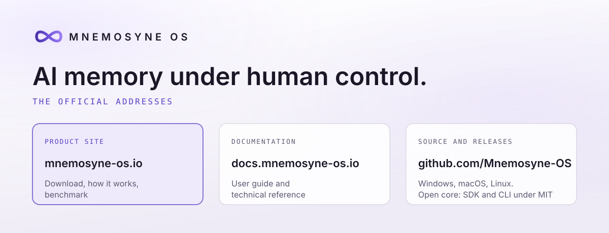

<picture>
  <source media="(prefers-color-scheme: dark)" srcset="assets/banner-dark.svg">
  
</picture>

# Mnemosyne OS

AI memory under human control.

Mnemosyne OS is a desktop app for Windows, macOS and Linux. It turns your
files and conversations into memory that any AI model you connect can draw
on. You decide what enters, what moves and what leaves. Your vaults live on
your own computer.

XPACEGEMS LLC publishes Mnemosyne OS. This repository lists its official
addresses.

## Official addresses

| What | Where |
|---|---|
| Product site | https://mnemosyne-os.io |
| Organizations: enterprise, research, public sector | https://mnemosyne-os.com |
| Documentation | https://docs.mnemosyne-os.io |
| Source code and releases | https://github.com/Mnemosyne-OS/Mnemosyne-Neural-OS |
| GitHub organization | https://github.com/Mnemosyne-OS |
| npm packages, scope `@mnemosyne_os` | https://www.npmjs.com/org/mnemosyne_os |
| Benchmark results and verifier | https://github.com/Mnemosyne-OS/MnemosyneOS---benchmarks |
| X | https://x.com/MNEMOSYNE_OS |
| YouTube | https://www.youtube.com/@MNEMOSYNE-OS |
| Discord | https://mnemosyne-os.io/discord |

## Download

The latest version is on the releases page:
https://github.com/Mnemosyne-OS/Mnemosyne-Neural-OS/releases/latest

The Personal tier is free.

## Start here

- [Ask questions about your PDFs, Word files and notes](https://mnemosyne-os.io/chat-with-your-documents).
- [Give Claude Code, Cursor or any MCP client your memory](https://mnemosyne-os.io/mcp).
- [See your coding agents as cards on your desktop](https://mnemosyne-os.io/agents).
- [Read how the memory works](https://mnemosyne-os.io/how-it-works).

## Benchmark

On LongMemEval-M, Mnemosyne OS answers 37 of 48 unseen questions correctly
(77.1%). The official LongMemEval judge (gpt-4o) scored them. Every answer and
every judge reply is published, with a verifier you run in one command:
https://mnemosyne-os.io/benchmark

## Licence

Mnemosyne OS is open core. The memory engine is sealed. The SDK, the CLI and
the npm packages are MIT.

## Cite

Tony Trochet, XPACEGEMS LLC. *The Resonance Engine*, technical whitepaper,
CC BY 4.0. DOI: https://doi.org/10.5281/zenodo.21728283
